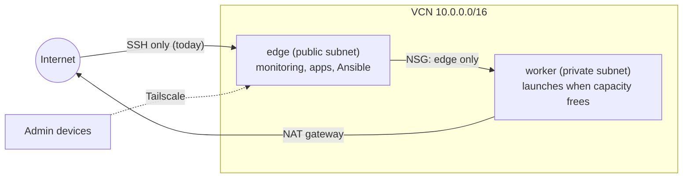

# oci-homelab

A small, production-style platform on Oracle Cloud's **Always Free** tier (ap-batam-1, Indonesia), built as code and run for **$0/month**.

> Status (2026-11): infrastructure, server baseline and monitoring are live. Public demos come next. A second private server is declared and launches automatically when Oracle frees capacity.

## What it shows

- **Infrastructure as code.** Terraform imports a hand-built VCN and server without recreating them, then adds a private subnet, NAT and service gateways, and per-role network security groups. Ansible configures the server idempotently.
- **Network design.** Public and private subnets, a worker reachable only from the edge's NSG, and a Tailscale overlay as the only path to admin interfaces.
- **Security by default.** Only SSH (keys only) answers from the internet. No admin UI on a public port. Secrets live outside git, and CI scans the full history with gitleaks.
- **Reviewed security.** A recorded review ([docs/SECURITY.md](docs/SECURITY.md)) probed the demos for SSRF bypasses, header injection, traversal and container escape paths; findings were fixed and regression-tested.
- **Observability.** Prometheus, Alertmanager, Grafana and Uptime Kuma, with Telegram alerts. One alert watches Oracle's idle-reclamation rule so the free server isn't taken back.
- **Operating under constraints.** The free tier caps ARM compute at 2 OCPU / 12 GB, so the existing server was shrunk in place. The second server's launch is retried from the first one using a launch-only instance-principal policy, with Telegram notifications ([ADR-006](docs/DECISIONS.md)).

## Architecture

Full picture, firewall layers and service list: [`docs/ARCHITECTURE.md`](docs/ARCHITECTURE.md).

## Stack

Oracle Cloud (A1 Flex ARM, VCN, NSGs, NAT gateway) · Terraform · Ansible · Docker Compose · Tailscale · Prometheus · Alertmanager · Grafana · Uptime Kuma · GitHub Actions · gitleaks

## Repository

| Path | What |
|---|---|
| `infra/terraform/` | Network, NSGs and both instances |
| `infra/ansible/` | Server roles and the monitoring stack |
| `infra/worker-retry/` | systemd timer that keeps trying to launch the worker |
| `infra/tailscale/` | Tailscale ACL policy |
| `docs/` | [Architecture](docs/ARCHITECTURE.md), [decisions](docs/DECISIONS.md), [runbook](docs/RUNBOOK.md), [status](docs/STATUS.md) |

## Roadmap

- [x] Audit, backups and lockdown of the existing server
- [x] Terraform import + private subnet, NAT, NSGs
- [x] Ansible baseline (SSH hardening, firewall, fail2ban, Docker, Tailscale)
- [x] Monitoring and Telegram alerting
- [x] CI: Terraform, Ansible lint, secret scan
- [x] Caddy as the single HTTP entry point (Ansible-managed)
- [x] Network looking glass (ping, mtr, DNS from Batam) with target validation and rate limits, tailnet-only for now
- [ ] Domain, public HTTPS and a public status page
- [ ] Self-hosted interactsh and a scope-limited recon pipeline for bug bounty
- [x] Paper-trading dashboard (equity curve, trades) from freqtrade via a read-only, field-whitelisting backend, tailnet-only for now
- [x] Request tracer: follows the visitor's own request hop by hop (entry path, Caddy, container) with live timings and the edge's paths to the internet and the private worker, tailnet-only for now
- [ ] Restore drill from backup

## Cost

$0. Every resource sits inside the Always Free limits (2 ARM OCPU / 12 GB, 200 GB block storage, 5 volume backups), checked after each change.
