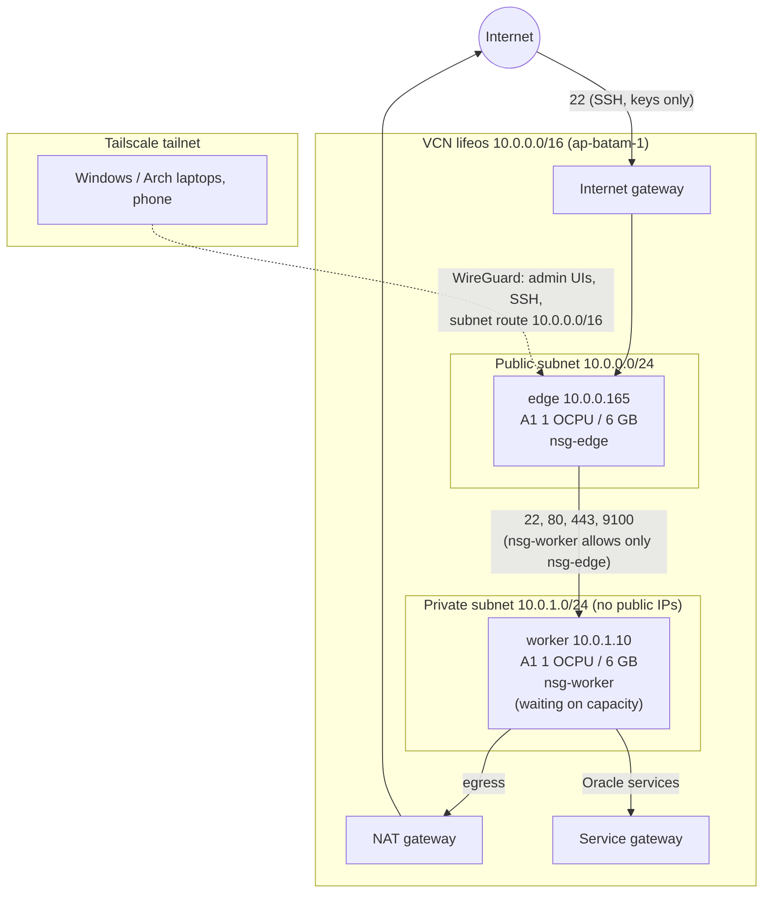

# Architecture

State as of 2026-11-11: one server (**edge**) does everything. A second, private **worker** is declared in Terraform and launches automatically if Oracle frees A1 capacity in Batam (ADR-009).

## Network

| Layer | What enforces it | Where it's defined |
|---|---|---|
| VCN edge | Default security list: SSH + ICMP only | `infra/terraform/network.tf` |
| Per role | `nsg-edge` (adds 80), `nsg-worker` (only from `nsg-edge`) | `infra/terraform/nsg.tf` |
| Host | iptables, rule by rule, Oracle's `InstanceServices` chain kept (ADR-007) | Ansible `firewall` role, `inventory/host_vars/*.yml` |
| Admin access | Tailscale only: Serve for web UIs, SSH over the tailnet; ACL draft in `infra/tailscale/policy.hujson` | Ansible `tailscale` role |

From the internet, only SSH answers today. Port 80/443 open publicly when Caddy and a domain arrive (Phase 3/5), each behind Tim's yes.

## What runs on the edge

| Service | How | Exposure |
|---|---|---|
| Prometheus, Alertmanager, Grafana, Uptime Kuma | Docker compose, host network, 127.0.0.1 | Tailscale Serve :9090 :9093 :3000 :3002 |
| Node exporter | systemd, :9100 | Private subnet + tailnet only |
| freqtrade (dry-run) | Docker, API on 127.0.0.1:8080 | Local only |
| Caddy (HTTP entry) | Docker, host network, :80 + 127.0.0.1:8091, admin/metrics 127.0.0.1:2019 | Public 80/443 closed until a domain exists |
| smartStudent | Caddy :80 (static SPA) + Node :3001 | Tailscale Serve :8443 |
| Looking glass (`apps/lg`) | Docker, 127.0.0.1:8090, behind Caddy :8091; NET_RAW only, read-only, 128 MB | Tailscale Serve :8446 |
| Trading dashboard (`apps/trading`) | Docker (host net, user nobody, no caps), 127.0.0.1:8092, behind Caddy :8093; reads freqtrade's API server-side with root-only credentials, whitelists fields, refuses non-dry-run | Tailscale Serve :8447 |
| readChinese | Next.js :3108 (pm2) | Tailscale Serve :8445 |
| Syncthing (Obsidian Vault) | systemd, GUI 127.0.0.1:8384 | Sync port 22000 not open publicly (host firewall) |
| Worker launch retry | systemd timer, instance principal, Telegram | Outbound only |

## Alerting

Prometheus rules (`infra/ansible/roles/monitoring/files/rules.yml`) to Alertmanager to Telegram:
InstanceDown, DiskAlmostFull, MemoryPressure, and **ReclamationRisk**. Oracle reclaims idle Always Free instances whose 7-day p95 CPU, network and memory are all under 20%, so the alert fires at 3 days to leave time to react. The Grafana dashboard "OCI Always Free reclamation" shows the same numbers.

## How it's built

| Concern | Tool | Notes |
|---|---|---|
| Cloud resources | Terraform (`oracle/oci` 7.x), local state | Existing VCN, gateways, subnets and the edge were **imported**, not recreated. Instances have `prevent_destroy`. |
| Server config | Ansible (control node = the edge) | Roles: base, ssh, firewall, docker, tailscale, node_exporter, monitoring. Second run is `changed=0`. |
| Secrets | Root-only files in `/etc/oci-homelab/` | Never in git; gitleaks runs in CI over full history. |
| CI | GitHub Actions | `terraform fmt`/`validate`, `ansible-lint`, syntax check, gitleaks. |

Decisions and their reasons: [`DECISIONS.md`](DECISIONS.md). Operating it: [`RUNBOOK.md`](RUNBOOK.md).
